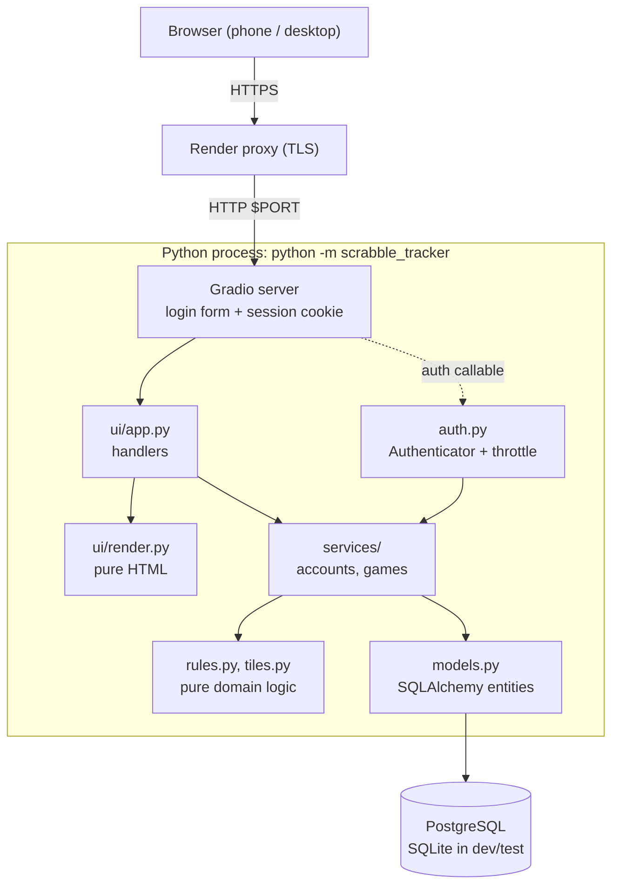
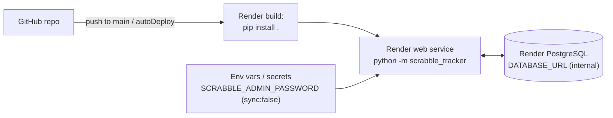

# Architecture — Scrabble Tracker

Reference: ISO/IEC/IEEE 42010 (architecture description) and SWEBOK v4 KA02.
Brief by design: proportional to the size of the system.

## 1. Stakeholders and concerns

| Stakeholder | Main concerns |
|---|---|
| Player | Fast input on a phone, correct scores, own statistics. |
| Administrator | Simple account management, safe defaults. |
| Maintainer | Readable, tested, easy to extend (new languages, rules). |
| Host operator (Render) | Binds `$PORT`, reads config from env, logs to stdout. |

## 2. Architectural style

A **modular monolith with a layered structure**, one Python process serving a
Gradio UI over HTTPS (TLS terminated by Render) and talking to PostgreSQL.
No separate API or SPA: the scale (a group of players) does not justify two
deployables and a versioned API contract (simplicity, SWEBOK §22).

**Dependency rule:** arrows point downward only. `rules.py`, `tiles.py` and
`ui/render.py` import neither Gradio nor a database, so they are tested in
isolation. `services/` never imports Gradio.

## 3. Module view

| Module | Single responsibility |
|---|---|
| `main.py`, `__main__.py` | Composition root: settings → logging → DB → bootstrap admin → UI → `launch`. |
| `config.py` | Typed settings from environment, fail-fast production validation. |
| `logging_config.py` | stdout logging with `key=value` context. |
| `db.py` | Engine/session factory, transaction scope, `create_all`. |
| `models.py` | Entities and state-derived calculations (scores, ranking, stats). |
| `rules.py` | End-of-game scoring rule as a pure function. |
| `tiles.py` | Tile values per language. |
| `security.py` | Password hashing, login throttling. |
| `auth.py` | Adapter between Gradio's login form and `services.accounts`. |
| `services/accounts.py` | Users, authentication, administration. |
| `services/games.py` | Game lifecycle, authorisation of game access. |
| `views.py` | Read-only DTOs built from ORM objects. |
| `ui/render.py`, `ui/labels.py` | Pure HTML and label text. |
| `ui/app.py`, `ui/theme.py` | Gradio layout, event wiring, CSS/theme. |

### Transaction and authorisation model

- **Unit of work per UI event.** `ui/app.py::run` opens one
  `session_scope`; services `flush` but never `commit`; the scope commits on
  success and rolls back on any exception.
- **Authentication** is performed by Gradio (`launch(auth=Authenticator)`);
  each handler resolves `request.username` to a `User` server-side.
- **Authorisation** is enforced in services (`get_game_for_user`,
  `require_admin`), not in the UI, so hiding a tab is cosmetic only.

## 4. Runtime and deployment view

- Single instance. In-memory state is the Gradio session store and the login
  throttle; both are lost on restart (users must sign in again).
- Procedure, variables and limits: `docs/DEPLOYMENT.md`.

## 5. Prioritised quality attributes

1. **Security** (public exposure): hashed passwords, throttling, escaped output,
   server-side authorisation, fail-fast config (`docs/THREAT_MODEL.md`).
2. **Maintainability**: layering, pure logic, tests, ADRs.
3. **Reliability of data**: managed PostgreSQL, transactional use cases.
4. **Usability on mobile**: Gradio responsive layout, light custom CSS.

Out of scope: horizontal scaling, real-time push updates (players press
*Refresh*), multi-tenant isolation.

## 6. Decisions

| ADR | Decision |
|---|---|
| [0001](adr/0001-persistence-choice.md) | SQLite + SQLAlchemy — **superseded** by 0003. |
| [0002](adr/0002-gradio-ui-framework.md) | Replace Flask with Gradio 6. |
| [0003](adr/0003-postgresql-for-production.md) | PostgreSQL for production, SQLite for dev/test. |
| [0004](adr/0004-authentication-model.md) | Gradio-native auth, administrator-provisioned accounts. |
