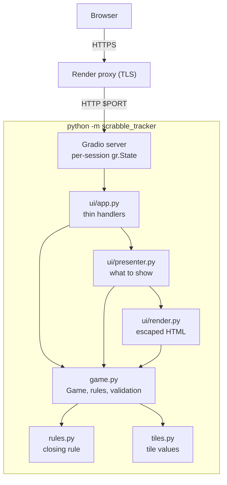

# Architecture — Scrabble Tracker (stateless edition)

Reference: ISO/IEC/IEEE 42010 and SWEBOK v4 KA02; intentionally brief.

## Style

A single Python process serving a Gradio UI. The only state is one `Game`
object per browser session, held in `gr.State` (ADR-0005). There is no
database, no file access and no module-level mutable state.

**Dependency rule:** arrows go downward only. Everything below `ui/app.py`
is plain Python and tested without Gradio.

## Modules

| Module | Responsibility |
|---|---|
| `main.py`, `__main__.py` | Entry point: settings → logging → build UI → `launch`. |
| `config.py` | Host/port/log level from the environment; zero config needed. |
| `logging_config.py` | stdout logging with `key=value` context. |
| `game.py` | The single-game model: validation, moves, scores, closing. |
| `rules.py` | End-of-game scoring rule (pure function). |
| `tiles.py` | Tile values per language. |
| `errors.py` | `DomainError` (user-facing message). |
| `ui/render.py`, `ui/labels.py` | Escaped HTML and label text. |
| `ui/presenter.py` | Converts a `Game` into display data (roster, boards, visible boxes). |
| `ui/app.py`, `ui/theme.py` | Gradio layout, event wiring, CSS/theme. |

## Quality attributes (priority order)

1. **Simplicity / deployability** — one dependency, zero configuration.
2. **Isolation and privacy** — per-session state, nothing stored.
3. **Maintainability** — pure, tested domain; thin UI.
4. **Usability on mobile** — Gradio responsive layout, light CSS.

## Decisions

See [`adr/`](adr): 0002 (Gradio) and 0005 (stateless single game) are active;
0001, 0003 and 0004 are parked for a future persistent version.
